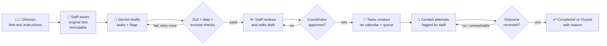
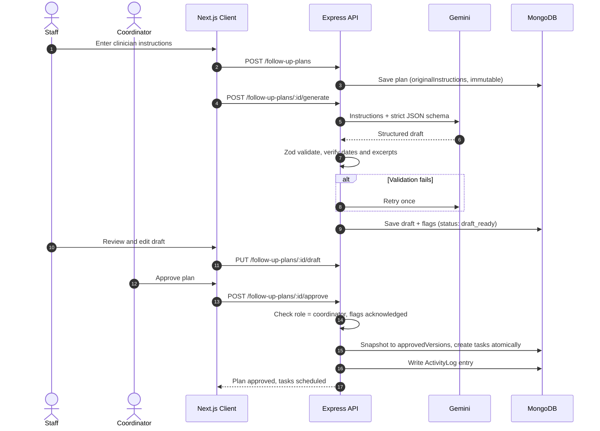
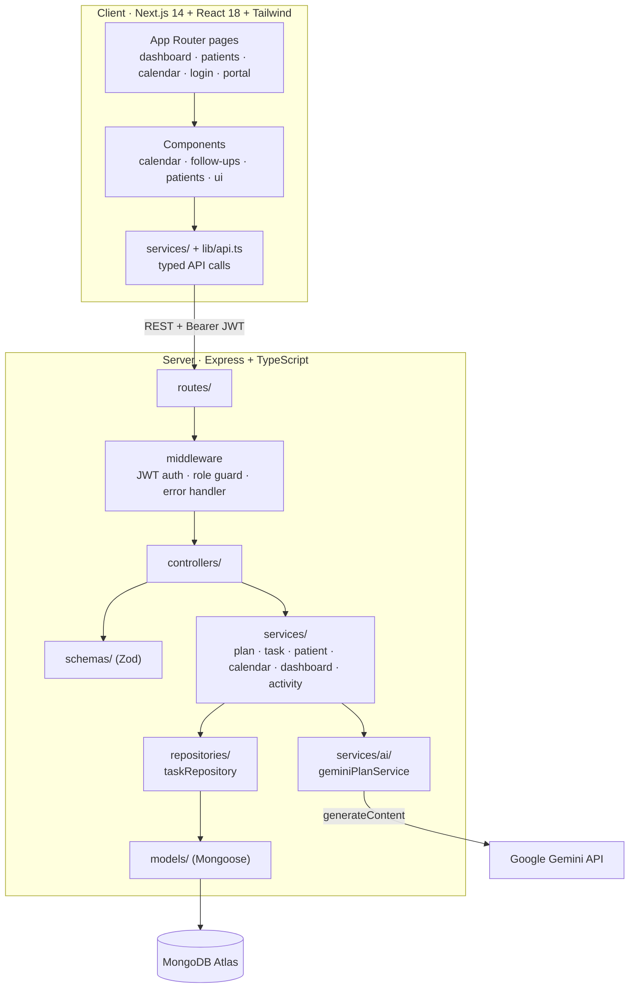
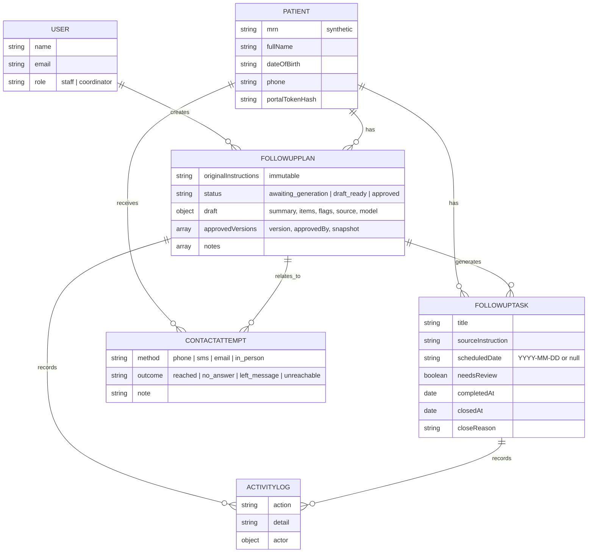
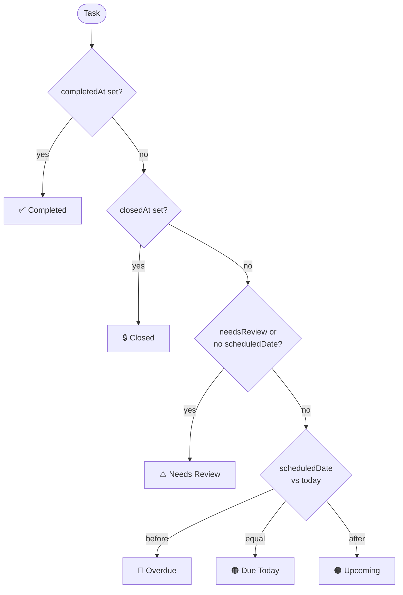
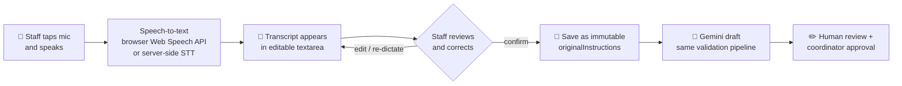
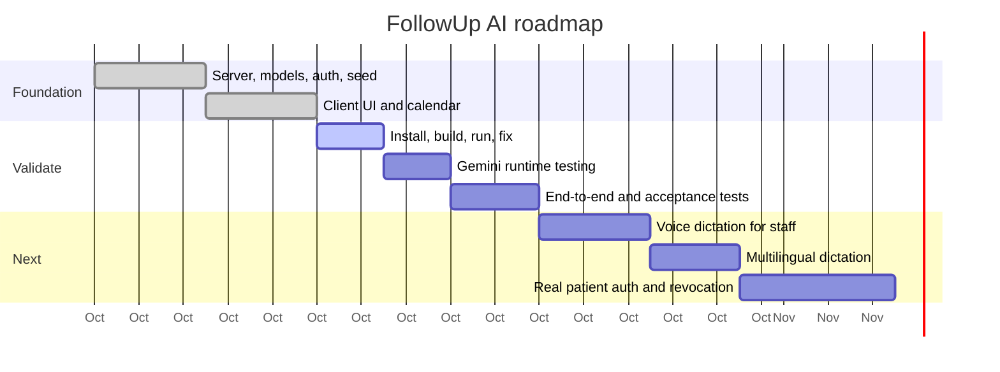

# 🩺 FollowUp AI

**Closing the follow-up blind spot in high-volume outpatient care.**

FollowUp AI turns free-text clinician instructions into reviewable, source-linked follow-up tasks. A human approves them, they land on an interactive calendar, and every case is tracked until a documented outcome is recorded.

> ⚠️ **Synthetic demo data only.** FollowUp AI is an *administrative coordination aid*. It does not diagnose, prescribe, change treatment, determine clinical urgency, or give emergency advice. Clinical judgement stays with authorised hospital staff.

Built for **AI Synergy Hackathon 2026 · Round 1 · Healthcare Case 03: "The Follow-Up Blind Spot"**.

---

## 📌 Table of Contents

1. [The Problem](#-the-problem)
2. [The Solution](#-the-solution)
3. [Scope](#-scope)
4. [Workflow](#-workflow)
5. [Architecture](#-architecture)
6. [Data Model](#-data-model)
7. [Task Status Logic](#-task-status-logic)
8. [Voice Dictation for Staff (Planned)](#-voice-dictation-for-staff-planned)
9. [Folder Structure](#-folder-structure)
10. [Tech Stack](#-tech-stack)
11. [Getting Started](#-getting-started)
12. [API Reference](#-api-reference)
13. [Safety, Privacy and Governance](#-safety-privacy-and-governance)
14. [Evaluation Plan](#-evaluation-plan)
15. [Project Status](#-project-status)
16. [Roadmap](#-roadmap)
17. [Limitations](#-limitations)

---

## 🔍 The Problem

Patients are identified as needing follow-up, but the hospital has no reliable, privacy-conscious way to turn free-text instructions into **owned tasks** and track each case to a recorded outcome.

| Signal | Value |
|---|---|
| Simulated outpatient visits per day | **900** |
| Marked for follow-up, did not return in the recommended window | **28%** |
| Records using a shared household phone | **19%** |
| Records with an unreachable phone number | **7%** |

*Figures come from the hackathon case evidence pack. They are scenario evidence, not verified hospital data, and they do not prove root cause.*

Reminders alone are not the answer. Shared phones, unreachable numbers, distance, inconsistent free-text instructions and limited staff capacity all interact. FollowUp AI targets the **testable workflow part**: reliable task creation, human ownership, status tracking and documented outcomes.

---

## 💡 The Solution

```
Clinician instructions → AI draft + flags → Staff review → Coordinator approval → Calendar + task queue → Documented outcome
```

- **AI drafts, humans decide.** Every AI plan is a draft until a coordinator approves it.
- **Source-linked.** Each task keeps the exact excerpt of the clinician's words it came from.
- **Grounded.** Dates are accepted only if the exact ISO date appears in the original instructions. Relative timing stays *unscheduled* until staff confirm it.
- **Closed loop.** Contact attempts are logged, and failed contact keeps the case open and visible.
- **Auditable.** Every consequential action is written to an activity log.

---

## 🎯 Scope

### ✅ In scope (MVP, implemented)

| Area | Capability |
|---|---|
| Auth and roles | JWT login, `staff` and `coordinator` roles. Only coordinators approve plans or close tasks |
| Patients | Create and search synthetic patients, patient detail page, activity timeline |
| Plan creation | Save clinician instructions (immutable original text) |
| AI drafting | Gemini generates a structured draft: summary, task items, source excerpts, flags |
| AI validation | Zod schema check, date verification against source text, excerpt verification, one retry, flags for missing or unverifiable items |
| Draft editing | Staff edit titles, descriptions, dates and review notes before approval |
| Approval gate | Coordinator approval snapshots the draft into `approvedVersions` and creates tasks atomically (no double approval). Open flags need `acknowledgeFlags: true` |
| Task queue | Search and filter by status, patient, plan. Checklist completion persists |
| Calendar | Month grid and agenda view. Undated tasks go to *Needs scheduling*, never onto the calendar |
| Contact log | Record phone, SMS, email or in-person attempts with an outcome (`reached`, `no_answer`, `left_message`, `unreachable`) |
| Dashboard | Stat cards, attention list, task finder |
| Patient portal | Private read-only `/portal/<token>` link showing approved tasks and dates |
| Audit trail | Activity log for plan creation, edits, approval, task changes, notes |
| Tests | Vitest unit tests for derived task status |

### 🎙️ In scope (planned, next)

| Area | Capability |
|---|---|
| **Voice dictation** | Staff speak follow-up instructions; speech is transcribed into the editable instruction box. See [Voice Dictation](#-voice-dictation-for-staff-planned) |
| Voice for notes | Dictate staff notes and contact-attempt notes |
| Multilingual dictation | Dictate in the staff member's language, with the transcript kept as the source text |

### 🚫 Out of scope

- Autonomous clinical decisions, diagnosis, prescribing, triage or urgency scoring
- Automatically messaging or calling patients (the app records staff attempts and never contacts patients itself)
- Counting a sent reminder as completion
- Solving transport, cost, availability or consent barriers
- Production patient identity verification, access revocation and real PHI handling
- Community health worker integration (a possible future role)
- EHR/HIS integration

---

## 🔄 Workflow



### Plan approval sequence



---

## 🏗️ Architecture



### Design principles

- **Derived status.** Task status is computed from stored fields and never stored, so counts cannot drift.
- **Immutable source.** `originalInstructions` can never be edited after creation.
- **Human gate.** Unapproved drafts never reach the active queue or the calendar.
- **No silent AI output.** Unverifiable dates or excerpts are flagged for human review instead of being trusted.
- **Timezone-aware.** "Today" uses `APP_TIMEZONE` (default `Asia/Kolkata`).

---

## 🗄️ Data Model



---

## 🚦 Task Status Logic

Status is **derived** at read time and never stored.



---

## 🎙️ Voice Dictation for Staff (Planned)

> **Status: planned scope. Not implemented in the current codebase.**

**Why:** Records staff in a 900-visit/day setting often have the clinician's instructions spoken or scribbled quickly. Dictation cuts typing time and makes capturing instructions faster, while keeping the human in control.

**Design rules**

1. Dictation only fills the **instruction text box**. Nothing is auto-submitted.
2. The transcript is shown in an **editable field**. Staff must read and correct it, then click *Save instructions and generate draft*.
3. The saved, reviewed transcript becomes the **immutable `originalInstructions`**. It is the single source of truth, and the AI never sees raw audio.
4. **Audio is not stored.** Only the reviewed text is persisted.
5. Spoken dates are transcribed as text, then go through the same grounded-date validation as typed text.
6. Dictation uses the same role permissions as typing.



**Planned implementation sketch**

| Layer | Change |
|---|---|
| Client | New `VoiceInputButton` component using the browser Web Speech API (`SpeechRecognition`), with live interim text, language selector and graceful fallback when unsupported |
| Client | Add the button to `CreatePlanDialog`, `NotesPanel` and the contact-attempt note field |
| Server (optional) | `POST /transcribe` endpoint for server-side STT where browser support or accuracy is insufficient |
| Safety | Show a "Review the transcript before saving" banner. Block saving an empty or unreviewed transcript |
| Tests | Accept-tests for: transcript stays editable, audio is not persisted, dictated dates are verified like typed ones |

**Privacy note:** browser speech recognition may send audio to a third-party service depending on the browser. Real deployment needs a privacy review and an approved STT provider.

---

## 📁 Folder Structure

```
FollowUp-AI/
├── README.md
├── .gitignore
│
├── client/                          # Next.js 14 front end
│   ├── package.json
│   ├── next.config.mjs
│   ├── tailwind.config.ts
│   ├── postcss.config.js
│   ├── tsconfig.json
│   ├── .env.example                 # NEXT_PUBLIC_API_URL
│   └── src/
│       ├── app/
│       │   ├── layout.tsx
│       │   ├── page.tsx
│       │   ├── globals.css
│       │   ├── login/page.tsx
│       │   ├── portal/[token]/page.tsx        # read-only patient view
│       │   └── (app)/                         # authenticated area
│       │       ├── layout.tsx
│       │       ├── dashboard/page.tsx
│       │       ├── calendar/page.tsx
│       │       └── patients/
│       │           ├── page.tsx
│       │           └── [id]/page.tsx
│       ├── components/
│       │   ├── calendar/        # AgendaView, MonthGrid
│       │   ├── dashboard/       # StatCard, AttentionList, TaskFinder
│       │   ├── follow-ups/      # CreatePlanDialog, DraftEditor, PlanPanel,
│       │   │                    # TaskList, TaskRow, TaskDetailDialog, NotesPanel
│       │   ├── layout/          # AppShell, PageHeader
│       │   ├── patients/        # ActivityTimeline, ContactPanel, NewPatientDialog
│       │   └── ui/              # Button, Card, Modal, Field, Feedback,
│       │                        # ProgressBar, Skeleton, StatusBadge
│       ├── hooks/               # useAsync, useTaskActions
│       ├── lib/                 # api, auth, cn, dates, status
│       ├── services/            # authService, patientService, planService, taskService
│       └── types/index.ts
│
└── server/                          # Express + TypeScript API
    ├── package.json
    ├── tsconfig.json
    ├── .env.example
    ├── tests/
    │   └── taskStatus.test.ts
    └── src/
        ├── server.ts            # entry point
        ├── app.ts               # express app
        ├── config/              # db.ts, env.ts (Zod-validated env)
        ├── routes/index.ts
        ├── middleware/          # auth.ts (JWT + role guard), errorHandler.ts
        ├── controllers/         # auth, followUp, patient
        ├── schemas/             # Zod: auth, common, followUp, patient
        ├── services/
        │   ├── ai/geminiPlanService.ts
        │   ├── follow-ups/      # planService, taskService, calendarService, dashboardService
        │   ├── authService.ts
        │   ├── patientService.ts
        │   └── activityService.ts
        ├── repositories/taskRepository.ts
        ├── models/              # User, Patient, FollowUpPlan, FollowUpTask,
        │                        # ContactAttempt, ActivityLog
        ├── types/express.d.ts
        └── utils/               # ApiError, asyncHandler, dates, regex, seed, taskStatus
```

---

## 🧰 Tech Stack

| Layer | Technology |
|---|---|
| Front end | Next.js 14 (App Router), React 18, TypeScript, Tailwind CSS, lucide-react |
| Back end | Node.js, Express 4, TypeScript, Zod |
| Database | MongoDB (Atlas) with Mongoose 8 |
| Auth | JWT (`jsonwebtoken`), `bcryptjs` password hashing, role-based access |
| AI | Google Gemini (`generateContent`) with strict JSON output and server-side validation |
| Testing | Vitest |
| Tooling | `tsx`, `tsc --noEmit` type-checking |

---

## 🚀 Getting Started

### Prerequisites

- Node.js 20+
- A MongoDB Atlas connection string
- (Optional but needed for AI drafts) a Gemini API key

### 1. Clone

```bash
git clone <your-repo-url>
cd FollowUp-AI
```

### 2. Server

```bash
cd server
cp .env.example .env     # fill in MONGODB_URI, JWT_SECRET, GEMINI_API_KEY
npm install
npm run seed             # ⚠️ WIPES the database and loads synthetic demo data
npm run dev              # http://localhost:4000/api/v1
npm run typecheck && npm test
```

**`server/.env`**

| Variable | Default | Purpose |
|---|---|---|
| `PORT` | `4000` | API port |
| `CLIENT_ORIGIN` | `http://localhost:3000` | CORS origin |
| `MONGODB_URI` | required | MongoDB connection string |
| `JWT_SECRET` | required, 16+ chars | Token signing secret |
| `JWT_EXPIRES_IN` | `8h` | Token lifetime |
| `GEMINI_API_KEY` | empty | Enables AI draft generation |
| `GEMINI_MODEL` | `gemini-3.8-flash` | Gemini model name |
| `APP_TIMEZONE` | `Asia/Kolkata` | Timezone for "today" |

### 3. Client

```bash
cd client
cp .env.example .env.local   # NEXT_PUBLIC_API_URL=http://localhost:4000/api/v1
npm install
npm run typecheck
npm run dev                  # http://localhost:3000
```

### 4. Demo logins

Password for both: `Demo#Pass123`

| Role | Email | Can |
|---|---|---|
| Coordinator | `coordinator@demo.test` | Approve plans, close tasks, everything staff can do |
| Staff | `staff@demo.test` | Create plans, edit drafts, complete tasks, log contacts |

---

## 🔌 API Reference

Base URL: `/api/v1` · Auth: `Authorization: Bearer <JWT>` (except login and portal).

| Method | Endpoint | Role | Description |
|---|---|---|---|
| `GET` | `/health` | public | Health check |
| `POST` | `/auth/login` | public | Log in, returns JWT |
| `GET` | `/patient-portal/:token` | public (token) | Read-only approved plan for a patient |
| `GET` | `/auth/me` | any | Current user |
| `GET` | `/dashboard` | any | Stats and attention list |
| `POST` | `/patients` | any | Create synthetic patient |
| `GET` | `/patients` | any | List / search patients |
| `GET` | `/patients/:id` | any | Patient detail |
| `POST` | `/patients/:id/contact-attempts` | any | Log a contact attempt |
| `POST` | `/follow-up-plans` | any | Save original instructions |
| `GET` | `/follow-up-plans/:id` | any | Get plan |
| `POST` | `/follow-up-plans/:id/generate` | any | Generate or retry the AI draft |
| `PUT` | `/follow-up-plans/:id/draft` | any | Save edited draft |
| `POST` | `/follow-up-plans/:id/approve` | **coordinator** | Approve and activate tasks |
| `POST` | `/follow-up-plans/:id/notes` | any | Add a staff note |
| `GET` | `/follow-up-tasks?status&patientId&planId&q` | any | Filter tasks |
| `PATCH` | `/follow-up-tasks/:id` | any (close: coordinator) | Update, complete or close a task |
| `GET` | `/calendar?month=YYYY-MM` | any | Calendar data for a month |

---

## 🔒 Safety, Privacy and Governance

| Control | How it is enforced |
|---|---|
| No invented clinical content | Gemini is instructed not to invent tasks or dates; output is Zod-validated |
| Date grounding | A date is accepted only if the exact ISO date appears in the original instructions |
| Excerpt verification | Each task's `sourceInstruction` is checked against the original text |
| Relative timing | "In two weeks" stays unscheduled until staff confirm a date |
| Human approval | Only coordinators approve. Drafts with open flags need explicit acknowledgement |
| Immutable source | `originalInstructions` is never editable |
| No false completion | Creating or logging a reminder never completes a task |
| Failed contact stays open | Unsuccessful attempts keep the case visible |
| Role-based access | Auth middleware plus `requireRole("coordinator")` |
| Audit trail | `ActivityLog` for consequential changes |
| Synthetic data | Seed script generates demo data only |
| Patient portal | Hashed token, read-only, cannot change completion. **Demo-grade only** |

---

## 📊 Evaluation Plan

| Measure | Baseline | Interpretation |
|---|---|---|
| **Primary:** follow-up task closure rate | Retrospective or shadow-mode sample before use | Compare share of due tasks with documented outcomes, before vs after, with denominator and window |
| **Process:** staff handling time per plan | Time a sample using the current manual workflow | Compare median minutes per plan. Do not assume improvement |
| **Harm:** unsafe contact events | Track shared-phone exposure, unverified contact, wrong-recipient events, unsafe AI suggestions corrected | Target zero known wrong-recipient disclosures; review every incident |

### Acceptance tests

| ID | Test |
|---|---|
| AT1 | **Grounded extraction:** explicit date + one ambiguous task → source text preserved, only supported tasks/dates proposed, ambiguous item flagged |
| AT2 | **Approval gate:** generated plan stays a draft and is absent from the active queue until approved |
| AT3 | **Failed contact stays open:** unsuccessful call keeps the case unresolved and visible |
| AT4 | **No false completion:** creating a reminder or logging a sent message does not complete follow-up |
| AT5 | **Privacy boundary:** unauthorised user cannot access another patient's plan; demo uses synthetic records |

---

## 🧭 Project Status

| Phase | State |
|---|---|
| 2. Server foundation (models, auth, API, seed) | Written, **not yet installed/type-checked/run** |
| 3. Client UI (pages, calendar, checklist, dashboard) | Files present, **not yet built or opened in a browser** |
| 4. UI ↔ API wiring | Services call the real API, **untested** |
| 5. Gemini plan generation | Implemented, requires `GEMINI_API_KEY`, **not yet runtime-tested** |
| 6. End-to-end testing | Not started |
| 7. Voice dictation | Planned |

---

## 🗺️ Roadmap



---

## ⚠️ Limitations

- A workflow tool cannot remove travel, cost, availability or consent barriers.
- Shared household phones create confidentiality risk. Contact must follow local consent and policy.
- AI can misread free text or infer dates incorrectly, so source text, editable drafts, flags and human approval are mandatory.
- The portal's token link is **not** production patient identity verification.
- Real deployment needs clinical governance, privacy/security review, usability testing and validation against local procedures.
- The prototype is a testable workflow proposal, not evidence that outcomes have improved.

---

## 📄 License and Provenance

Built for AI Synergy Hackathon 2026, Round 1. Case figures are scenario evidence from the Participant Case File *"The Follow-Up Blind Spot"*. The problem framing and solution are the team's design decisions and remain hypotheses to validate.
